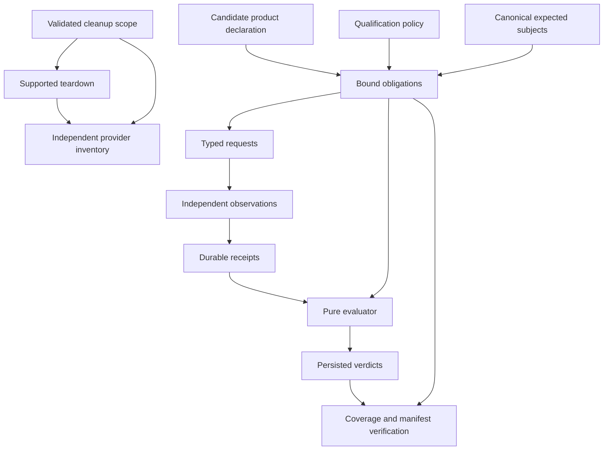

# Typed qualification architecture

The accepted direction is a small set of authoritative OCaml owners for requirements,
selection, observations, execution, evidence and failure accounting. Provider-specific
implementations remain where the provider behavior differs. Qualification independently
establishes whether Sol satisfied its declared contract.

This document preserves the design from [#1487](https://github.com/sol-fab/sol/pull/1487)
without its experimental executable. The shared domain and durable recorder landed in
[#1490](https://github.com/sol-fab/sol/pull/1490) and
[#1494](https://github.com/sol-fab/sol/pull/1494). They support explicitly bound offline
**MECHANISM** fixtures only. They cannot qualify an installed release or replace a live
assertion. No live policy authority has moved. The [implementation plan](implementation-plan.md)
sets the remaining comparison, review and deletion gates.

## Ownership and dependency direction

| Owner | Owns | Must not own |
|---|---|---|
| Product contract declaration | Candidate-specific names, types, paths, binding semantics and advertised capabilities | Qualification applicability or permission to omit a required claim |
| Qualification policy | Required claim families, evidence classes, scopes, cardinality and explicit applicability decisions | Product naming rules or provider observation mechanisms |
| Selection | Complete expected subjects and bindings from canonical intent; exclusions with reasons | Inferring expected membership from deployed resources or operator subsets |
| Obligation binder | Expand the policy over complete expected subjects, independently of the planner | Accepting only the requests a planner happened to generate |
| Typed planner | Materialize each bound obligation as a correctly typed request | Redefining required membership or declaring success |
| Observer | Independently collect typed facts about bound subjects and actual execution context | Choosing the obligation universe or evaluating success |
| Pure evaluator | Match requirement to observation and evaluate its predicate | I/O, command execution, persistence or mutable global state |
| Executor | Structured argv, identity/context, finite timeout and process result | Qualification verdicts, automatic privilege fallback or expected-refusal interpretation |
| Evidence recorder | Safe capture, persistence/provenance integrity, immutable references and verified manifests | Reimplementing observation-to-requirement predicates |
| Reconciliation | Exact plan/outcome/capture coverage and full instance identity | Repeating applicability rules or semantic predicates |
| Lifecycle supervisor | Failure capture, already-authorized cleanup and independent inventory accounting | Replacing concrete provider phases with a generic workflow engine |
| Provider inventory scope and observer | Complete owned-resource classes, attribution, pagination and independent observations | Inferring absence from destroy success or narrowing coverage to successful reads |

Cleanup authority does not depend on successful database-contract binding or evidence
storage. Unknown ownership never authorizes destruction. Product declarations and
qualification requirements remain distinct inputs, even where their pure types are shared.

## Implemented domain and its limits

The current API is [qual_domain.mli](../tooling/sol_qualification/lib/qual_domain.mli),
with implementation and offline tests described in the
[package contract](../tooling/sol_qualification/sol_qualification.md). It provides abstract
run, intent, selection, obligation and instance types; distinct abstract CA, DML,
administrative-binding, TLS and migration requirement payloads; and pure evaluation.
These concrete interfaces are authoritative for implemented behavior, rather than the
illustrative module signatures in the original proposal.

There are three separate universes: expected consumers, applicable obligations, and observed
resources/outcomes. Complete selection does not prove complete deployment or observation.
The experimental catalog expands independently of planning. Exact coverage rejects missing,
duplicate and unexpected requests/outcomes. Full instance identity includes kind, subject,
workload/database binding and run/contract identity; a matching string key is insufficient.
Persisted verdicts retain that identity and are checked against independently supplied
obligations during both sealing and recovery.

Reviewed golden manifests independently test catalog membership and expansion. They are test
oracles, not a second runtime catalog. A candidate capability flag cannot remove an obligation.
A complete expected set of five consumers with four successful observations still needs an
account for the fifth: FAIL, UNKNOWN, NOT_RUN or an unrecorded persistence failure.

The administrative-binding predicate establishes only absence of references to a declared
administrative Secret. Ordinary DML credentials can legitimately use the same field names as
administrative credentials. Neither reference absence nor a declared DML class proves actual
PostgreSQL authority or rules out arbitrary copied secret bytes. **DML authority verification
remains a required future qualification obligation before release adoption.** Unresolved
source provenance must remain unreadable, not become an empty reference set.

## Observation, verdict and persistence boundaries

| Outcome | Meaning |
|---|---|
| PASS | Sufficient, correctly scoped evidence establishes the specific requirement |
| FAIL | Authoritative observations falsify it, including positive absence of a required object |
| UNKNOWN | The attempted observation or prerequisite is unreadable, ambiguous or incorrectly scoped |
| NOT_RUN | The requirement was not dispatched; cite a persisted blocker |
| Persistence error | Operational failure without a fabricated evidence reference or recorded verdict |

The evaluator alone matches observation subject, candidate/run/assessment, expected binding
and, once implemented, endpoint/identity freshness. The recorder validates structural
provenance and persistence. The coordinator dispatches correctly typed requests; it does not
implement another version of the predicate. A command result or an in-memory decision is not
a durable qualification verdict.

The future shared Kubernetes observer must exercise
[#1497](https://github.com/sol-fab/sol/issues/1497) as an adversarial classification case.
Forbidden, timeout, process-launch failure, malformed output and incomplete listings cannot
establish absence. A failed provider command never establishes Absent. Absence requires a
positively established authoritative result for the bound subject. For a required-presence
claim that result is FAIL; for a required-absence claim it may establish PASS. An empty
successful subset is not proof of complete discovery.

The AWS and GCP database contracts should share one Kubernetes observation implementation
with bound provider context. Reuse candidate-owned declarations and schemas, while observing
Kubernetes independently of Sol's renderer/apply path. Cross-test real rendered artifacts
against declared expectations; do not compare a renderer against itself.

## Worked CA path

The end-to-end observer/decoder integration below is still future work; the domain
and recorder operations already exist for fixtures:

1. Bind the run to its contract and scenario, select expected consumers from canonical
   intent, and expand the independent catalog into obligations.
2. Plan a typed CA request for one expected consumer, retaining its full instance identity.
3. Independently read the declared Kubernetes object in the bound identity/endpoint context.
   Project only safe facts: actual namespace/name, CA key, volume and consuming-container mount.
4. Commit the observation and provenance, then decode the verified stored facts into the
   matching typed observation. A successful read whose write failed has no usable receipt.
5. The pure evaluator checks receipt identity and the CA predicate. Persist that decision
   with its actual observation dependencies; reconcile all obligations and required captures
   before sealing. Verify the named manifest again when consuming the result.

A correctly scoped positive observation can establish PASS. A successfully observed missing
required CA is FAIL. A Forbidden/timeout observation is UNKNOWN, not absence. If evidence
persistence fails, return an operational error without inventing an UNKNOWN receipt or PASS;
the separately authorized cleanup path must remain usable.

## Durable evidence and recovery

The implemented API is [qual_evidence.mli](../tooling/sol_qualification/lib/qual_evidence.mli).
It uses private temporary files, file synchronization, content-addressed no-replace hard-link
publication, and containing-directory synchronization. Dependencies commit first; references
are returned only after successful publication and sync. Readers verify hashes, sizes, kinds,
assessment provenance, dependency closure and exact verdict-evidence correspondence.

A final manifest names one explicit assessment. Sealing and consumption check independently
bound obligations and complete outcome identities; neither searches for a green assessment.
An assessment's additional required capture slots are persisted before observations, so a
failed required capture cannot disappear across restart after all other verdicts passed.
Successful recapture can fill that slot. Lost optional diagnostics do not redefine coverage.

One writer lock protects an attempt. Conflicting outcomes are rejected rather than overwritten.
Explicit reassessments preserve earlier records and cite their history; a later PASS does not
diagnose an earlier failure. Committed observations without verdicts, verdicts without a final
manifest, partial writes and corrupt dependencies cannot silently establish success. Recovery
reverifies and synchronizes complete published graphs before returning a verified result.

The local producer, executable and OS account are trusted. Hashes detect corruption and
structural misuse; they do not authenticate a producer able to replace the whole store.
Durability assumes the filesystem honors acknowledged synchronization. Registered secrets
and sensitive structured fields are removed before temporary writes, but unknown-secret
detection is not promised: observers must choose safe projections and register secret inputs.
No signatures, remote evidence service or workflow database is introduced.

Persistence failure prevents successful qualification but must not suppress authorized
cleanup. I2 does not yet implement lifecycle integration, production execution identity,
preflight recording before contract resolution, or release-verdict consumption.

## Candidate, execution and lifecycle requirements still to implement

A production run must bind the exact candidate revision/archive and deterministic product-owned
contract projection, plus the independently advancing harness/policy revision. Generate the
projection from canonical typed owners and cross-test its names, paths and runtime/renderer
artifacts. Do not manually maintain another declaration table or guess by release version.
Unsupported or missing projections fail closed. Existing candidates, including alpha.37, must
not be rebuilt or implicitly supported to accommodate this framework. Offline fixtures do not
stand in for release binding.

Execution must record requested and observed identity and endpoint at observation time.
The approved initial freshness rule is one stable context per observation batch until credential
expiry or five minutes after verification, whichever comes first. Changes to role, credentials,
helper, kubeconfig or endpoint, and authentication failure invalidate it. A read extending beyond
that boundary requires fresh proof or remains UNKNOWN. This is revalidation at use, not a
credential watcher or a provider identity call for every command. Before dispatch of a qualification mutation, record the impending action; after
dispatch it may have mutated even if no completion result arrives. Secret values must stay out
of printable argv; timeout/signal/spawn failures retain safe underlying diagnostics.

Concrete AWS/GCP/local phases remain initially. Share failure accounting before generalizing
phase APIs. Persist/checkpoint evidence before teardown, invoke supported cleanup for validated
scope even after a possibly mutating command fails, then independently inventory every required
resource class. Report action result, contract verdict, evidence completeness and absence
separately. An expected refusal needs a dedicated evaluator over the action and independent
post-state; nonzero exit alone neither passes nor fails that contract.

Retained durable prerequisites and disposable owned resources need distinct inventory scopes.
Unknown inventory classes leave absence unestablished, regardless of destroy success. Cleanup
cannot be guaranteed after SIGKILL, host failure or credential revocation; existing bound-attempt
destroy/verify continuation remains the recovery path. New qualification code must consume or
replace existing candidate/attempt/transaction owners, not create parallel authorities.
