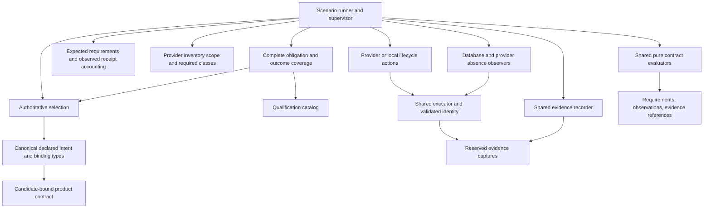

# Proposed qualification ownership model

Status: proposal for review in draft PR #1487. The signatures below describe the
next design, not APIs implemented by the prototype. No harness migration is part
of this proposal. The existing campaign entry points remain authoritative until
their replacements have been reviewed and verified.

The direction has been approved; these interfaces remain proposed. The focused
review resolution assigns receipt matching solely to the evaluator, adds a complete
obligation universe, separates product declarations from qualification policy, and
defines durable evidence commit/recovery. The [implementation plan](implementation-plan.md)
names the mechanisms to remove and the tests required at each cutover. No framework
implementation or live-harness migration is included in this revision.

## Findings that determine the boundaries

| Existing owner | Mechanism or decision to consolidate | Boundary to preserve |
|---|---|---|
| AWS `live-row.sh`: `run`, `bootstrap_deploy`, `capture_state`, `capture_kube_evidence` | Bounded execution, command records, diagnostic capture | Interactive setup is an explicit command mode; deploy is still through the installed Sol artifact |
| GCP `live-qual.sh`: `run`, repeated branches in `phase_app`, `freeze_evidence`, `finalise_bundle`, `verify_bundle` | Execution records, capture accounting, required evidence, finalization | A successful capture invocation does not mean all its reads succeeded |
| Local `local-qual.sh`: `run_logged`, `write_run_identity`, `phase_capture` | Execution, run identity, evidence manifest | Local behavioral evidence cannot establish a cloud/provider claim |
| AWS/GCP `app_services` / `APP_UNITS`, `app_unit_addresses`, `app_namespaces` | Workload membership, consumer selection, addresses | A list of example services is not proof that every database consumer was selected |
| AWS/GCP `app_verify_database_delivery`; AWS `app_verify_database_ca` | Shared database delivery assertions | Kubernetes reads must remain independent of Sol's write/apply path |
| Local `rows-ocaml.sh` / `rows-ts.sh`: `run_row`, `check_eq`, `check_ge`, `wait_until` | Verdict accounting and bounded observations | Language-specific workloads, queries and scenarios remain distinct; preserve behavioral parity |
| `sol-under-test.sh`, `candidate-binding.sh`, `attempt.sh` | Already shared release/specimen binding | Consolidate by consuming or migrating these owners, not by keeping parallel validators |
| AWS `cleanup` / `phase_destroy`; GCP `cleanup` / `destroy`; local `phase_teardown` | Phase completion, failure capture and cleanup accounting | Different ownership scopes and intentional phase boundaries are not duplication |
| AWS `absence.py`; GCP `inventory` / `provider_probe`; local `cluster_verdict` / `container_verdict` | Uniform observation and verdict envelope | Provider attribution, pagination, identity checks, retention and positive absence remain independent provider reads |
| `transaction.py`, AWS transaction transports, GCP `app_orders_transaction` | Preserve the existing shared structural predicate; consolidate evidence envelopes | Replacing the shared Python predicate with a second OCaml predicate would duplicate ownership |

Source references: [AWS harness](../aws/live-row.sh), [AWS absence](../aws/absence.py),
[GCP harness](../gcp/live-qual.sh), [GCP observer](../gcp/observer.py),
[local harness](../local/local-qual.sh), [OCaml rows](../local/rows-ocaml.sh),
[TypeScript rows](../local/rows-ts.sh), [qualification rules](../README.md).

One concrete defect demonstrates why these boundaries matter: the prototype's
ConfigMap projection checks `ca.crt`, and its offline adapter repeats that premise.
The product's [`Sol_cli_manifest_cluster_env`](../../../cli/lib/workspace/sol_cli_manifest_cluster_env.ml)
declares `db_ca_file_name = "ca.pem"`; the database renderer uses that declaration.
The 31 offline scenarios verify the prototype's mechanism, not agreement with this
product key. A live ConfigMap produced correctly by Sol would fail that prototype
predicate. Adoption must fix the authoritative key input and include a fixture with
the actual contract field. The current executable is not ready to replace either
harness assertion. It stays unchanged during this design-only revision.

There are other limits to preserve explicitly. GCP currently accepts a DML Secret
in any consuming namespace; that is weaker than every selected consumer receiving
its binding. AWS's CA check inspects a volume reference, not each container mount
or a TLS connection. Local row drivers report PASS/FAIL and run deployment before
rows; their envelopes do not currently distinguish all unreadable prerequisites.
These are differences to resolve in contract requirements, not semantics to erase
silently during migration. This proposal does not claim they are all production bugs.

## Authoritative inputs and the shared domain

The matrix remains the home of the claim ID, scope and required evidence class.
A contract implementation owns its executable predicates. Bind the two through
one requirement catalog: any future generated matrix table is a projection of
that catalog, not another manually maintained registry of checks. Existing matrices
stay authoritative until that change is reviewed. Run records stay evidence, and
GitHub stays the work-state authority.

Authority flows in one direction:

```text
Candidate product declaration + qualification policy + scenario/expected subjects
                    -> complete applicable obligations
                    -> typed requests and recorded outcomes
```

The product declaration owns names, types, paths, binding semantics and advertised
capabilities. Qualification policy owns claim IDs, applicability, evidence class,
subject-expansion/cardinality rules and exclusions. Capability flags are facts for
evaluating support, not permission to remove obligations. If policy requires TLS
and the candidate omits TLS support, the TLS instance remains required and blocked
or falsified according to the policy's explicit rule; it never becomes inapplicable
just because the candidate says so. An unresolved declaration prevents binding; an
otherwise resolved declaration lacking a required capability prevents qualification.

Generate the candidate projection deterministically from existing canonical typed
contract definitions, using stable ordering/encoding and no timestamps or manually
copied field tables. The schema/codec is defined at that same product owner, with
one supported interpretation initially. Cross-tests must independently inspect real
product-rendered ConfigMap keys, Deployment volumes/mounts/credential references and
runtime connection inputs against the projection, rather than compare two calls to
the same renderer. Mutating either the projection or the rendered artifact's CA key
must fail. Projection repeatability and bundle-byte verification are necessary but
do not prove agreement with the renderer/runtime.

During migration, existing Markdown/TSV matrices remain policy authority and the
experimental catalog is non-authoritative. A focused policy cutover must review
all row IDs, scope and expansion rules together, make the catalog authoritative,
and generate the policy columns of matrix projections in that same change. Historical
evidence references remain records and do not define policy. Remove superseded
provider-required-check lists then; do not operate two independent runtime catalogs.

Use a small qualification domain with these concepts:

| Type | Meaning and source |
|---|---|
| `Attempt.t` | Existing attempt/candidate/harness binding before the full run contract is resolved; permits preflight capture, not qualification evaluation or mutation |
| `Run.t` | Validated artifact/workspace/harness binding, attempt, specimen, target, scenario and authorization scope; abstract, constructed by one run-binding owner |
| `Candidate_contract.bound` | Supported product-owned contract bound to the immutable candidate; required to construct a qualification `Run.t` |
| `Claim.t` | Matrix ID, required evidence class and applicable environment/language scope; no caller-controlled success flag |
| `Claim_instance.t` | One catalog claim bound to a subject and assessment/phase, with its obligation key and candidate/policy identity; distinguishes five consumers of the same claim |
| `Intent.t` | Canonical declared application/target intent at the candidate revision, before applying it |
| `Binding.t` | Declared resource addresses, credential classes, keys and CA mount contract; product-owned names/types, never inferred naming rules |
| `Consumer.t` | Selected database/resource consumer, language, workload/container identity and its declared binding |
| `Evidence.reference` | Reference to an immutable evidence member within this run, carrying provenance and capture status |
| `Evidence.nonempty` | One reference plus zero or more additional references; every recorded observation and qualification verdict must cite persisted evidence |
| `Evidence_error.t` | Capture/persistence stage and safe underlying diagnostics; constructible without evidence references |
| `Issue.t` | Original execution/provider diagnostic with concise qualification context and safe redaction |

For the proposed signatures, these are shared domain modules, not unintroduced
dependencies on production deploy code. Their definitions must remain small and
specific to qualification. Abstract types have one constructor-owning module;
declaring a type abstract in a signature alone does not establish a trustworthy owner.
Constructor-owning components can be nested within one implementation module to
restrict access. These logical signatures do not require one file per interface
or public builder functions that would let observation adapters forge verdicts.

Provenance records the attempt/specimen, candidate and installed bundle identity,
application revision and framework binding, harness revision, target/provider/location,
requested and observed execution identity, command/observation times and origin.
Evidence class and environment scope are separate: a real local observation is
BEHAVIORAL for a local claim, never behavioral evidence for an AWS/GCP claim.
Fixtures are MECHANISM, regardless of whether an adapter labels its payload "live".
Only the run-binding owner establishes origin and scope, and the evaluator checks
them against the claim. Evidence recording does not choose or promote claim scope.

### Candidate contract identity

```ocaml
module Candidate_contract : sig
  type identity = private
    { schema : Contract_schema.t
    ; candidate_revision : Revision.t
    ; bundle_sha256 : Sha256.t
    ; declaration_sha256 : Sha256.t
    }
  type bound

  val bind :
    Verified_candidate.t -> Candidate_declaration.t ->
    (bound, Contract_binding_error.t) result
  val identity : bound -> identity
  val bindings : bound -> Binding.catalog
end
```

Use the existing `sol-under-test.sh` verification of candidate revision, installed
bytes and `bundle_sha256`, and `candidate-binding.sh` for materialized application
intent. Add one product-owned machine-readable contract projection to the candidate
bundle through a separately reviewed product change. It declares schema, product
keys/paths, binding semantics and supported capabilities; it is generated from the
canonical contract owner, not maintained as a second set of constants. Concrete
target addresses subsequently declared by the candidate must be decoded under this
same contract and bound to this run. The projection is a proposed prerequisite:
today's candidate document does not already contain it or a `contract_version`.

`bind` checks the declaration came from the exact verified bundle, checks its stated
revision, validates its schema and contents, and records its digest in the contract
identity. Candidate version text alone is insufficient. A newer harness uses the
older candidate's declared values, such as its CA key, through a supported decoder;
it never imports today's product constant as that candidate's authority. Importing
pure product types remains useful for implementing the decoder, but does not choose
the candidate's values or certify support for its semantics.

Initially support one explicit schema/semantic contract. Missing, malformed,
mismatched or unsupported declarations return `Contract_binding_error`, before
selection or new mutation. Do not parse old OCaml source text, execute a source
checkout to guess its contract, infer from a version string or fall back to the
harness's current bindings. An existing older candidate without this authoritative
projection is unresolvable under this proposal and must be refused until a separately
reviewed declaration mechanism exists; this does not retrofit the active campaign.
No version registry, adapter chain or general compatibility framework is proposed.

Every requirement and observation carries this bound identity alongside run/specimen
and subject identity; reconciliation and evaluation reject mismatches. Selection
also uses the matching candidate's intent, not the harness checkout's example list.
Record the harness/requirement-policy revision separately: the candidate declaration
describes product behavior; it cannot weaken the matrix's required claims. An absent
required capability blocks qualification explicitly, rather than removing its checks.
If contract binding fails, record that preflight blocker if possible and mark the
scenario NOT_RUN; if recording also fails, return an unrecorded operational failure.

## Proposed interfaces

These signatures establish responsibilities rather than a plugin API. Supporting
types named below are the closed Sol qualification domain described here. This
document is deliberately not a new library or a set of executable `.mli` files.

### Observation and verdict

```ocaml
module Observation : sig
  type 'a state = Present of 'a | Absent | Unknown of Issue.t
  type 'a pending
  type 'a t = private
    { state : 'a state
    ; evidence : Evidence.nonempty
    }
  (* pending contains decoded facts, subject/contract identity and diagnostics,
     with no invented references. Only a successful recorder commit creates t. *)
end

module Captured : sig
  type 'a t =
    | Recorded of 'a Observation.t
    | Capture_failed of Evidence_error.t
end

module Verdict : sig
  type decision =
    | Pass
    | Fail of Counterexample.t
    | Unknown of Issue.t
    | Not_run of Blocker.t

  type t = private
    { claim : Claim_instance.t
    ; decision : decision
    ; evidence : Evidence.nonempty
    }
end

module Claim_outcome : sig
  type t = private
    | Verdict_recorded of Verdict.t * Evidence.reference
    | Unrecorded of Claim_instance.t * Evidence_error.t
end
```

The contract evaluator constructs evaluated verdicts. The runner's accounting
module constructs NOT_RUN for requirements it never dispatched, citing a persisted
blocker or explicit unsupported-capability decision. An absent object is a fact:
it fails a required-presence claim and passes a required-absence claim. An
unreadable object is UNKNOWN, never proof of either. Missing expected evidence
also prevents PASS, even when an action completed successfully.

An observation can be decoded in memory and still fail to persist. The recorder
returns `Capture_failed`, not `Recorded (Unknown ...)` with a nonexistent reference.
`Evidence_error.t` contains the failed stage (open/reserve/write/flush/finalize) and
safe diagnostics, including the original observation error when available. It
requires no evidence. A reference is issued only after its member and required
provenance have been successfully committed; a partial file is not a valid receipt.

`Claim_outcome.Verdict_recorded` is constructed only after the verdict record also
commits, with its reference separate from the decision's supporting evidence. There
is no circular requirement for a verdict to cite its own file. If that write fails
after evaluation, use `Unrecorded`; do not pretend the
decision was persisted. A blocked requirement receives NOT_RUN only when its blocker
is persisted. If persisting the blocker fails, its outcome is likewise `Unrecorded`.
These operational outcomes are not a fifth qualification verdict and cannot be
used as evidence by another claim. They prevent successful qualification and a
conformant final manifest, even if other claims have recorded PASS verdicts.

Recorder failure does not revoke already established cleanup authority or suppress
supported teardown. Stop new qualification mutations, attempt authorized cleanup
and independent inventory, and retain whatever diagnostics remain possible. If the
store stays unavailable, report capture failure through the process result and safe
stderr; never label that fallback a recorded UNKNOWN, NOT_RUN or absence verdict.

Keep every leaf verdict. A run is acceptable only if every required applicable
claim has a recorded PASS at the right evidence class/scope, there are no unrecorded
outcomes, and evidence finalization succeeds.
FAIL and UNKNOWN can coexist in one run; do not flatten them into a summary that
loses the unknown reads. NOT_RUN is never an exemption from a required claim.
Inapplicable claims have an explicit catalog scope decision, not a fabricated PASS.

| Leaf decision | Example | Evidence required |
|---|---|---|
| PASS | Declared CA key is nonempty at the consumer's declared location | Requirement/binding reference, complete-selection reference, validated identity and successful independent object/key projection |
| FAIL | An authoritative successful read positively finds no required CA object | Same scope references and the positive absence response; retain the counterexample |
| UNKNOWN | Kubernetes returns Forbidden or the projection cannot be decoded | Requested/observed identity, execution outcome and original safe diagnostic or malformed-response capture |
| NOT_RUN | DML observation was never dispatched because selection or identity was unresolved | Persisted prerequisite/selection failure or explicit unsupported-capability decision, with a link to the blocked requirement; no invented observation |

If any row's required evidence cannot be persisted, it produces an operational
`Unrecorded` outcome instead of the table's qualification verdict.

### Selection and requirements

```ocaml
module Selection : sig
  type 'a complete
  type incomplete = { issue : Issue.t }

  val database_consumers :
    Run.t -> Intent.t ->
    (Consumer.t complete, incomplete) result

  val members : 'a complete -> 'a list
  val coverage : 'a complete -> Coverage.t
end

module type CONTRACT = sig
  type obligation
  type requirement
  type recorded_check

  val plan : obligation -> (requirement, Planning_error.t) result
  val claim : requirement -> Claim_instance.t
  val evaluate : recorded_check -> Verdict.t
end
```

The policy binder consumes complete consumer selection or provider-scope coverage
as appropriate; those authorities are not interchangeable. A contract planner
translates each already required obligation into one typed request, or an explicit
planning error. It does not decide which obligations exist.
`recorded_check` is a closed sum of correctly paired requirement/fact types for
that contract, demonstrated below; there is no universal optional-field fact record.

`Selection` alone constructs `complete`: callers cannot wrap arbitrary lists in
`Complete`. It enumerates canonical target membership, applies the declared resource
dependency relation, resolves the declared workload addresses, and records included
and excluded members with reasons and source revision. It cannot certify completeness
from running pods, a provider's returned subset, or an operator's `--consumer` list.
No selected object is allowed to disappear merely because observing it failed.

Selection validity and evidence persistence are separate properties. `Coverage.t`
is the in-memory account of canonical membership, exclusions and source identity;
the recorder must persist it before a universal verdict can cite selection evidence.
An `incomplete` value can exist even if the recorder is broken. The runner attempts
to record that blocker and produces UNKNOWN coverage plus dependent NOT_RUN only
on successful persistence; otherwise it produces unrecorded operational outcomes.

An intentionally partial diagnostic run can use a separate explicit subset input;
it cannot call the universal qualification evaluator. Empty complete selection
does not automatically satisfy a scenario that requires database consumers: the
requirement catalog owns the nonempty-exercise requirement.

Product intent is the membership authority. Reuse pure canonical contract types
and decoding where available; do not call the deploy selection/render/apply path
and treat its returned objects as independent completeness evidence. Where the
current declared contract does not provide enough information to establish binding
addresses or membership, return `incomplete`. Review the missing product declaration
at its owner before migration; do not invent names in the qualification reader or
build a parallel planner.

The policy binder below is the sole expansion from complete subject selection into
obligations. Observers cannot omit an obligation by omitting a resource from their result.
A recorded failed selection is an UNKNOWN coverage claim; its dependent delivery
checks are NOT_RUN with the same evidence. Known consumers may still be observed diagnostically,
but cannot establish the universal claim.

### Requirement-universe completeness

```ocaml
module Obligations : sig
  type complete
  type instance = Claim_instance.t
  type key
  val bind :
    Qualification_policy.t -> Run.t -> Consumer.t Selection.complete ->
    (complete, Applicability_error.t) result
  val instances : complete -> instance list
  val key : instance -> key
  val reconcile_plan : complete -> Planned_request.t list ->
    (Plan_coverage.t, Coverage_error.t) result
  val reconcile_outcomes : complete -> Claim_outcome.t list ->
    (Outcome_coverage.t, Coverage_error.t) result
end
```

`complete` is constructed by interpreting the one catalog's explicit expansion
rules over candidate-bound intent and scenario. It includes required instance keys
and recorded applicability decisions, with a reason for every exclusion. A key
contains claim ID, scenario/scope, subject or database identity, and assessment/phase;
the manifest also binds policy, candidate contract and complete-selection identities.
Shared migration input is per database, not multiplied accidentally per consumer.
Unknown applicability is an explicit blocker, not an exclusion. An empty universe
does not establish a scenario requiring a database exercise.

For a representative policy requiring CA, DML, no-master-copy and TLS for each of
five consumers, the authoritative obligation set has 20 distinct keys. The typed
planner cannot redefine that count: it receives individual instances and materializes
requests. The runner reconciles actual planned keys against the bound obligation set
before execution, and outcome keys against the same set before finalization. Missing,
duplicate, unexpected or wrong-subject keys make coverage unacceptable, even if all
returned decisions say PASS. Missing planned work receives recorded NOT_RUN with a
planning-coverage blocker, or an unrecorded outcome if persistence fails. There is
no loop whose acceptance condition is merely "all generated requests passed".

`reconcile_plan` compares keys/multiplicity; it does not repeat catalog applicability
rules or evaluate observations. The evaluator alone decides whether a receipt proves
a specific instance. The final acceptance gate requires both plan/outcome coverage
and every required recorded PASS, plus valid final evidence.

Two independent test boundaries protect this:

- Planner mutation: bind the unchanged five-consumer catalog, then delete one CA,
  DML or TLS request (or every TLS request). Each mutation must fail exact-key
  coverage before any successful subset can qualify. Also mutate duplicate and
  unexpected keys and omission of a failed/unreadable outcome after execution.
- Catalog mutation: remove a required rule or weaken its applicability. Reviewed,
  hand-authored golden instance manifests for representative AWS/GCP/local scenarios
  must disagree and fail. The golden oracle is not generated by the catalog or
  planner, and is never loaded as a second runtime catalog. Legitimate policy changes
  update it under review with an explanation, rather than silently reblessing output.

### Expected selection and observation reconciliation

Keep three separate values: the complete expected consumer set from canonical
intent, independently observed Kubernetes identities, and an accounting entry for
each expected requirement. A complete expected set says nothing about successful
deployment or observation. The reconciliation owner accounts for every expected
instance key and detects missing, duplicate or unexpected outcomes. The evaluator
alone matches each observation's provenance/subject/binding to its requirement;
reconciliation does not repeat that semantic check. It never substitutes the observed set for the expected
set or removes members after failed reads.

| Account for an expected workload | Meaning | Recorded result |
|---|---|---|
| Valid independently read object | Workload exists; evaluate its typed delivery facts | PASS or FAIL according to the actual facts |
| Successful authoritative read positively returns no object | Required deployment is missing | FAIL for required presence; dependent reads needing that object are NOT_RUN |
| Forbidden, timeout, malformed or incomplete listing | Existence/delivery is unreadable | UNKNOWN for the attempted requirement; blocked dependents are NOT_RUN |
| Requirement was not dispatched because a prerequisite failed | No workload observation was made | NOT_RUN citing the persisted blocker |
| Read or blocker cannot be persisted | Operational accounting only | `Unrecorded`; no qualification verdict |

For example, five expected consumers and four successful Kubernetes reads do not
yield complete delivery. The fifth must be positively absent (FAIL), unreadable
(UNKNOWN), blocked (NOT_RUN), or unrecorded (capture failure). If list pagination
is incomplete, the unmatched member is UNKNOWN, never inferred absent. Prefer
explicit reads of expected addresses when those establish authoritative absence;
the type system alone cannot prove listing completeness. A reconciled account can
be exhaustive even when every member failed: exhaustive accounting is not PASS.

Unexpected observed workloads are retained as diagnostics or evaluated by a separate
explicit no-extra-workloads requirement if the contract has one. They do not repair
a missing expected workload or establish cleanup ownership. Reconciliation emits
its own coverage evidence; if that cannot be persisted, the universal result remains
unrecorded regardless of the successful leaf reads.

### Execution and identity

```ocaml
module Identity : sig
  type t
  val establish :
    Run.t -> Role.t -> (t, Issue.t) result
end

module type EXECUTOR = sig
  val execute :
    Identity.t -> Command.t -> Execution.pending
end
```

`Role.t` is a closed set of scenario roles: operator, publisher, deploy,
cluster-access and qualification transport. `Identity.establish` validates the
scenario-required principal and endpoint/account/project binding and returns an
opaque handle. The executor applies that handle's explicit environment/kubeconfig;
it does not silently fall back to ambient credentials or retry as operator.
Requested identity and observed caller identity remain separate evidence.
Authentication expiry, server-side authorization and endpoint changes still require
runtime checks and produce UNKNOWN on failure.

Identity validation first produces an in-memory handle or issue; recording that
fact is a separate capture operation. A qualification verdict needs the recorded
identity evidence. Already authorized cleanup can use a validated handle even when
recording fails; an evidence error neither invents identity nor authorizes escalation.

Each observation references its actual execution identity/endpoint proof, not just
the run's initial check. The initial policy is one stable credential/endpoint context
per observation batch, valid until the earlier of known credential expiry or five
minutes after verification. Invalidate it on credential, role, helper, kubeconfig
or endpoint changes and on authentication failure. A read extending beyond that
window needs fresh proof or remains UNKNOWN. Record the provider-observed principal
where available; a requested role name is not proof of execution identity. If an
adapter cannot establish a stable context, it must not assume one. This is a scoped
freshness rule and revalidation at use, not a new credential watcher or STS call for
every trivial command. The evaluator owns whether that proof meets the claim's rule.

`Command.t` owns argv, working directory, finite timeout, nonsecret environment,
secret inputs by opaque handles/stdin, allowed capture projection and an explicit
interactive/noninteractive mode. Secret values must not be printable argv fields.
The alpha.37 driver's useful property is loading a password outside argv; its
store path and parsing are operator configuration, not a runner contract.

`Execution.pending` distinguishes completed exit status, timeout, signal and spawn
failure, retaining partial safe diagnostics, timings and any staging output. It is
an operational result, not an evidence reference. The recorder commits execution
captures and returns real references; capture failure can coexist with a completed
process. Normal qualification work requires its recorder/preflight gates; supported
cleanup must still execute with safe diagnostic fallback if capture reservation or
commit fails. Both paths use the same process mechanism. The executor owns process
handling, not expected refusal, retries, provider error reinterpretation, claim
success or cleanup policy. Use existing process facilities or GNU timeout for
mechanics; do not introduce another supervisor/retry system. The current CLI helper's
timeout result omits partial output, which is a real gap to resolve before sharing
that helper rather than a reason to duplicate all command semantics permanently.

### Database observation capability and the common contract

```ocaml
module Database_delivery_contract : sig
  type requirement =
    | Ca_delivery of Ca_requirement.t
    | Dml_delivery of Dml_requirement.t
    | Migration_input of Migration_requirement.t
    | Tls_connectivity of Tls_requirement.t
    | No_master_copy of No_master_requirement.t

  type recorded_check =
    | Ca_checked of Ca_requirement.t * Database_ca_facts.t Observation.t
    | Dml_checked of Dml_requirement.t * Database_dml_facts.t Observation.t
    | Migration_checked of Migration_requirement.t * Database_ddl_facts.t Observation.t
    | Tls_checked of Tls_requirement.t * Database_tls_facts.t Observation.t
    | No_master_checked of No_master_requirement.t * Unit_secret_facts.t Observation.t

  val plan : Database_obligation.t -> (requirement, Planning_error.t) result
  val evaluate : recorded_check -> Verdict.t
end

module type DATABASE_DELIVERY = sig
  val ca :
    Run.t -> Ca_requirement.t -> Database_ca_facts.t Observation.pending
  val dml :
    Run.t -> Dml_requirement.t -> Database_dml_facts.t Observation.pending
  val migration_input :
    Run.t -> Migration_requirement.t -> Database_ddl_facts.t Observation.pending
  val tls :
    Run.t -> Tls_requirement.t -> Database_tls_facts.t Observation.pending
  val unit_secret :
    Run.t -> No_master_requirement.t -> Unit_secret_facts.t Observation.pending
end
```

Each `*_requirement.t` is a distinct abstract payload constructed by the typed
planner from its catalog instance. It exposes the appropriate consumer/database
binding, expected values, requirement ID and bound contract identity to its observer.
The catalog owns subject expansion and deduplication; planning only materializes it.
`recorded_check` pairs each payload with its specific recorded fact type: a DML
observation cannot inhabit `Ca_checked`, and a TLS observation cannot inhabit
`Migration_checked`. There is no `evaluate requirement generic_facts` entry point.
All dispatch/evaluation matches are exhaustive, with no wildcard that would silently
accept a new requirement. Ordinary variants suffice; no GADT is proposed.

Types distinguish fact kinds, not individual runtime consumers. **The evaluator
alone owns receipt-to-requirement matching**: requirement/subject, run/specimen,
candidate contract, assessment and expected binding, including relevant identity
and observation-time freshness policy. A well-typed CA receipt for another consumer
is unusable evidence for this requirement and produces UNKNOWN, never PASS. A valid
matching receipt showing a wrong declared key/reference is a counterexample and FAIL.

The recorder checks bytes, hashes, capture completeness and the truthfully recorded
provenance envelope; it does not compare that envelope with a requirement or decide
whether a ConfigMap key/mount is correct. The coordinator dispatches typed requests,
persists outcomes and returns them; it does not implement receipt matching. Coverage
reconciliation compares required instance keys and multiplicity, not the semantic
suitability of their observations. These are distinct questions, each decided once.

The capability observes; the contract evaluates. The signatures of their facts
must record what was actually read: resource identity and namespace, key presence,
credential class reference, pod volume and container mount/key references, and the
source/execution evidence. No caller-provided `delivered = true` field stands in
for those facts. Credential values stay out of retained facts and diagnostics.

| Requirement/fact pair | Actual observation content |
|---|---|
| CA / `Database_ca_facts` | Workload/ConfigMap identities, declared CA key and nonempty-key projection, volume source and container mount references |
| DML / `Database_dml_facts` | Consumer credential reference/class, actual Secret identity and nonempty declared-key projection; no password value |
| Migration / `Database_ddl_facts` | Database/migration Job identity, DDL reference and delivered input key |
| TLS / `Database_tls_facts` | Bound consumer probe, endpoint, verified connection outcome and safe diagnostics; not a ConfigMap boolean |
| No master copy / `Unit_secret_facts` | Authoritative projection of the relevant unit Secret's prohibited-key presence; a denied read stays unreadable |

Requirements distinguish CA delivery, DML delivery, DDL migration input, no master
credential copy and application/TLS behavior. Object/key presence and correct
references cannot prove that a password is DML-only or that a TLS handshake succeeded;
those need separately defined behavioral probes. Checking no master copy must itself
positively read the relevant unit Secret/projection; a failed read is UNKNOWN.

CA key, path, credential class and resource binding are inputs from the product-owned
contract at the candidate revision. Whether Kubernetes contains those objects/keys
is an independent observation. The current database identity log does not declare
every DML address or consumer reference: this is a declaration gap to settle before
implementing the full contract, not permission to reproduce `target ^ "-dml-creds"`.

The same assembly works for AWS and GCP:

```ocaml
module Aws_delivery = Kubernetes_database_delivery (Aws_read_context)
module Gcp_delivery = Kubernetes_database_delivery (Gcp_read_context)

module Aws_check = Check_database_delivery (Aws_delivery)
module Gcp_check = Check_database_delivery (Gcp_delivery)

(* Both Check_database_delivery instances consume the same catalog's obligations,
   use the common typed planner and call the same evaluate function. Only the
   observation context and provider-backed setup facts differ. *)
```

`Kubernetes_database_delivery` owns common Kubernetes reads/decoding once. The
context modules supply validated identities and endpoints, not different assertions.
`Check_database_delivery` dispatches each closed requirement to its matching observer,
records the returned pending observation, and evaluates only `Captured.Recorded`
with the corresponding `*_checked` constructor. `Capture_failed` bypasses evaluation
and produces an unrecorded operational outcome. The check coordinator also commits
the computed verdict before returning `Verdict_recorded`. It
does not own selection. Local can instantiate this capability only for declarations
its scenario actually supports; local plaintext/application behavior does not imply
support for the cloud CA/credential-class scenario.

### Evidence and provenance

```ocaml
module type EVIDENCE = sig
  type recorder
  val open_attempt : Attempt.t -> (recorder, Evidence_error.t) result
  val preflight : recorder -> Preflight.event ->
    (Evidence.reference, Evidence_error.t) result
  val bind_run : recorder -> Run.t ->
    (Evidence.reference, Evidence_error.t) result
  val reserve_capture : recorder -> Capture_spec.t ->
    (Evidence.capture, Evidence_error.t) result
  val execution : recorder -> Execution.pending ->
    (Evidence.reference, Evidence_error.t) result
  val observation : recorder -> 'a Observation.pending -> 'a Captured.t
  val verdict : recorder -> Verdict.t ->
    (Evidence.reference, Evidence_error.t) result
  val checkpoint : recorder -> Checkpoint.t ->
    (Evidence.reference, Evidence_error.t) result
  val finalize : recorder -> Required_evidence.t ->
    (Evidence.manifest, Evidence_error.t) result
  val verify_manifest : Attempt.t -> Evidence.manifest_reference ->
    (Evidence.verified_manifest, Evidence_error.t) result
end
```

Open evidence under the existing attempt binding before resolving the candidate
contract, so unsupported-contract failures can be captured without manufacturing
a `Run.t`. Before `bind_run` succeeds, only preflight/operational records are
permitted: no observation receipt or qualification PASS can claim full run provenance.
If opening the attempt itself fails, return an operational `Evidence_error` without
any reference. Do not require a successfully recorded open-failure event to return it.
`Preflight.event` is a closed set of attempt/candidate/contract binding results,
not a general event log or a second work-state store.

This is one evidence owner, including capture reservation, safe projection/redaction,
file ownership, immutable references, provenance and manifest integrity. The scenario
and requirement catalog declare required evidence; the recorder verifies it exists
and belongs to the right run. It does not decide whether a provider fact satisfies
a product invariant. A pending observation includes its closed safe capture
projection and source execution/provenance, so `observation` commits those dependencies
before issuing its typed receipt. It does not accept a provider-supplied reference
to a nonexistent file. No additional observer/codec plugin registry is required.
Account for capture failure operationally and continue independent captures when feasible;
do not confuse "capture accounted for every read" with "every read succeeded".

`checkpoint` preserves the pre-teardown evidence prefix without making the bundle
unwritable. Later teardown observations and the final manifest are appended separately;
they cannot overwrite a failed observation. `finalize` accounts for all declared
requirements, including NOT_RUN and missing captures, and reports incomplete evidence.
Evidence-write failure prevents a conformant PASS but must not suppress authorized
cleanup. Preserve the underlying diagnostic with safe redaction. A local stderr
fallback is an operational diagnostic, not a substitute for a valid manifest.

Use the existing attempt directory and continuation binding; do not add a second
workflow database or local project-status file. Each phase invocation has distinct
capture members within the bound attempt, so continuation does not overwrite prior
evidence or silently make a new specimen reuse an old attempt.

### Evidence commit, finalization and continuation

The recorder targets a local POSIX filesystem supporting atomic publication and
successful file/directory `fsync`. Unsupported or failed durability operations
are capture errors; do not silently downgrade to buffered-only evidence. Storage
hardware honoring acknowledged synchronization is a trust assumption, not something
OCaml types or hashes can prove. This is a small immutable file store, not a database
or an event-sourcing framework.

| Boundary | Required operation before acknowledging it |
|---|---|
| Streaming/staging diagnostics | Private temporary files; no qualification reference is issued and no per-line `fsync` is required |
| Committed evidence member | Finish the safe payload and provenance envelope, flush, hash exact bytes with SHA-256, `fsync` the file, atomically publish without replacement, then `fsync` the containing directory |
| Recorded observation/verdict | Commit all its referenced dependencies first, then its own immutable envelope through that same member protocol; return a receipt only after success |
| Final qualification manifest | Verify complete obligation/outcome coverage and every transitive reference, commit the manifest with the same protocol, then return its digest as the final seal |
| Consumption of PASS | Load the explicitly named sealed manifest, recheck its identity, hashes, sizes, schemas, dependency closure and required coverage; a cached boolean or filename is insufficient |

Use exclusive temporary creation on the same filesystem and modes 0700/0600.
Publish members at `members/<sha256>` with an atomic no-replace operation, for
example a hard link from the synced temporary file followed by directory sync.
A plain overwriting rename is insufficient. If the hash path already exists,
verify the existing regular file's exact bytes/length/hash before reusing it;
never overwrite it. Sync newly created parent directories as well. Clean up the
temporary name after publication; leftover temporaries remain non-authoritative.
Any failed write, flush, sync or publication returns `Evidence_error`; neither a
partial member nor an ambiguous acknowledgement becomes a receipt.

The hashed envelope binds payload, source execution/identity/endpoint, capture time,
candidate contract, policy and attempt/assessment provenance. References name hash,
size and member kind, and readers validate those fields and dependency closure.
Content addressing does not prove that a provider response is true or that evidence
satisfies a requirement: observation independence and pure evaluation still own
those questions. Corruption after a receipt was issued is detected again before
finalization and whenever the sealed manifest is consumed.

Finalization is an immutable snapshot, not an overwritable `report.json`. It lists
the chosen assessment, complete obligation set, applicability decisions, all outcome
references, history/supersession references and evidence-integrity results. A file
that happens to contain PASS is never authoritative without a verified seal. A crash
before the final file and its directory are synced yields no acknowledged final seal;
on recovery, a fully published manifest may be accepted only after full verification,
never because it sorts last. Recovery re-syncs verified files/directories before
reissuing a durable seal; file presence cannot prove a prior sync completed.
The existing release-verdict path must consume a verified
manifest reference before this recorder is allowed to support release promotion;
do not introduce a second release policy or bypass the existing qualification gates.

Continuation follows the existing attempt/candidate/specimen binding and uses one
OS advisory writer lock per attempt; the lock is not persistent workflow state and
is released on process exit. It inspects committed members and manifests, validates
every referenced byte and reports incomplete/corrupt dependencies. Unpublished
temporaries and unreferenced members may be retained for diagnosis but cannot silently
be promoted into observations or PASS. A partial manifest is not a valid run result.
Missing/corrupt members produce evidence failure, not a fallback to an older green
manifest or regeneration from a log that resembles the expected output.

New invocations append new assessment/member IDs without altering earlier references.
Within an assessment there must be exactly one selected outcome for each obligation;
duplicate/conflicting decisions fail coverage rather than use "last write wins".
Reassessment is explicit: a new ID, fresh observations where policy requires them,
a reason, and references to all superseded results. Earlier failures remain visible;
a later PASS never diagnoses or deletes them. No automatic retry-to-green policy
is introduced. The final manifest identifies the assessment being evaluated and
the verifier checks its phase/generation and freshness rules, so pre-destroy or
earlier-specimen observations cannot satisfy post-destroy/current obligations.

Failure of this store stops new qualification mutations, not already authorized
teardown or independent inventory. Those operations use validated ownership/identity
and safe diagnostic fallback; unpersisted results remain operational outcomes and
cannot establish a release verdict. No new work-state journal or reconciliation
daemon is needed to recover the immutable evidence that actually reached disk.

### Lifecycle, supervision and absence

```ocaml
module type ABSENCE_SCOPE = sig
  type resource_class
  type coverage
  val required_classes :
    Owned_scope.t -> (coverage, Issue.t) result
  val classes : coverage -> resource_class list
  val coverage : coverage -> Coverage.t
end

module type ABSENCE_OBSERVER = sig
  type resource_class
  val observe :
    Owned_scope.t -> Identity.t -> resource_class ->
    Resource_inventory.t Observation.pending
end
```

Defer a universal lifecycle module signature. AWS/GCP/local retain concrete phase
functions and their existing order while execution, evidence, contract evaluation
and handled-failure accounting consolidate. The shared supervisor is a small
integration boundary around those concrete operations: capture/checkpoint, invoke
already authorized teardown, independently inventory, and finalize. A process or
capture failure must reach that boundary even if a phase cannot return a normal
recorded result. Do not require every phase to implement a new generalized API.

The scenario binder checks required capabilities before mutation. Unsupported required
capabilities yield explicit recorded NOT_RUN decisions or unrecorded capture errors
and an unacceptable run; the adapters cannot implement a missing capability as a
successful no-op. The bound scenario connects concrete phases, observation capabilities
and the recorder for a reviewed Sol scenario. No dynamic plugin registry or arbitrary
workflow DAG is needed.

The existing concrete scenario retains phase order and operator pauses initially.
The shared integration boundary owns requirement accounting and handled-failure
transition into capture/cleanup. Concrete phases own their commands, not separate
verdict aggregation or finalization mechanisms. Extract common ordering later only
where consolidation demonstrates a need; preserve AWS publisher context, GCP
setup/delegation and local provisioning without a new lifecycle API hierarchy.

`Owned_scope.t` is validated from the declared target and operator authorization,
not discovered by a naming guess after failure. It distinguishes disposable target
resources, run-owned publication artifacts, durable prerequisites and policy-retained
objects. Review provider retention and attribution at the provider boundary. One
authoritative required-class enumerator exists per provider/scope, consumed by its
observer and the common absence evaluator; a provider cannot submit a smaller list
of successful reads and have it interpreted as complete.

Here `coverage` is abstract and constructed only by that provider's inventory-scope
owner, not by arbitrary read adapters. It is deliberately distinct from the consumer
selector's `complete` type: the owners certify different universes. The provider's
closed class set and full enumeration need hostile/exhaustiveness tests; an abstract
type cannot prove its implementation did not forget a resource class.
The scenario binder pairs `ABSENCE_SCOPE` and `ABSENCE_OBSERVER` with the same
`resource_class` type. The observer cannot choose the required set or certify its
own returned subset as complete.
Independent inventory needs the validated attempt/target scope and identity, not
the database contract or a writable evidence store. This also permits existing
authorized destroy/verify recovery when qualification contract binding cannot be
resolved. If ownership or authority itself cannot be established, do not construct
the scope or destroy by guesswork. Recovery diagnostics alone cannot repair a
missing qualification run binding or establish the complete scenario's PASS.

Supervision is a small fixed sequence:

1. Bind candidate, attempt, selection, identities, required capabilities and cleanup
   authority before issuing a mutating command. Persist the impending action before
   dispatch; from dispatch onward it may have mutated even if no result is received.
2. On failure, timeout or cancellation, account for the blocked requirements and
   attempt all relevant bounded captures. Checkpoint before destructive cleanup.
3. Invoke supported teardown for the validated owned scope, then independently
   inventory every required resource class even when teardown returned nonzero.
4. Preserve post-teardown evidence and finalize. Report contract verdicts, destroy
   execution outcome, absence verdict and evidence completeness as separate results.

Unknown resource state does not establish absence. Unknown ownership or authorization
does not grant permission to destroy. Conversely, a timed-out authorized deploy may
have created resources: it must not evade supported cleanup because a log marker was
never printed. Teardown cannot remove durable prerequisites simply to obtain green
absence. Scenario policy must define separate obligations for intentionally retained
resources, and retained durable infrastructure must never masquerade as disposable
residue or disappear from accounting.

The common absence evaluator quantifies over the complete required classes; each
provider observer owns identity verification, authoritative discovery, pagination,
attribution and interpretation of documented provider responses. Preserve AWS's
existing independent observer and its hostile fixtures initially; wrap its structured
observations, not merely its overall exit code. Do the same for GCP/local inventories.
Neither successful Terraform/Sol destroy nor an empty Terraform state establishes
provider absence. Destroy success and absence success remain separate facts.

Existing explicit specimen retention for delegation/application phases must be a
reviewed scenario boundary with recorded reason and cleanup obligation, not a generic
`KEEP=1` escape from failure handling. Whether those existing boundaries remain is an
operator/design decision before migration; this proposal does not authorize changing
the campaign's behavior. Cleanup is attempted on handled failures and cancellation;
no in-process type or finalizer guarantees cleanup after SIGKILL, host failure or
revoked credentials. Existing bound-attempt destroy/verify continuation remains the
recovery path, and unresolved absence remains UNKNOWN/FAIL as appropriate.

## Worked CA path

This is a proposed execution trace, not evidence from a real candidate or a new
implementation. Use a supported candidate C, a newer harness H, and an AWS or GCP
specimen. The same Kubernetes observer and evaluator run in either case.

1. **Run binding.** Existing candidate verification establishes C's bundle digest
   and revision. Open the bound attempt, resolve C's product contract projection,
   and bind its schema/revision/declaration digest into `Run.t`. Record H separately.
   In this example C declares the CA key `ca.pem`; H supplies no substitute key.
2. **Expected consumers.** Selection enumerates C's target intent and returns five
   consumers with complete in-memory coverage. Persist that coverage and the validated
   observation identity. Kubernetes has not yet established the presence of any of them.
3. **Typed requirement.** The bound policy first expands the complete obligation set;
   the planner materializes `Ca_delivery ca_req` for consumer
   `payments/charge-svc`, including its declared ConfigMap, CA key, volume/mount
   expectations and run/contract/subject IDs. This payload is a `Ca_requirement.t`,
   not a DML or TLS request. Plan coverage must match every required instance;
   other consumers and TLS/DML obligations cannot disappear from that universe.
4. **Kubernetes observation.** The common observer uses the validated kubeconfig to
   read the expected workload and ConfigMap independently. It projects identities,
   nonempty `ca.pem` presence and the required volume/container references, then decodes
   `Database_ca_facts.t Observation.pending`. Command success alone does not establish
   the claim; no CA or credential contents are retained.
5. **Evidence recording.** The recorder commits those projected reads, command
   outcomes, identity, C's contract identity and selection links. Only then does it
   return `Captured.Recorded observation`. Any missing dependency or failed commit
   instead returns `Capture_failed`.
6. **Verdict.** The coordinator constructs `Ca_checked (ca_req, observation)`. The
   evaluator checks the receipt's scope and CA facts and returns PASS with supporting
   evidence. The coordinator persists that decision before returning
   `Verdict_recorded (verdict, decision_ref)`. Reconciliation still requires an account
   for the other four expected consumers and all other required checks.

The CA branch of the coordinator has this shape; all other branches use their own
payload/fact pair. Constructor ownership remains with the coordinator/recorder:

```ocaml
let check_ca recorder run ca_req =
  let pending = Observer.ca run ca_req in
  match Recorder.observation recorder pending with
  | Capture_failed error ->
      Unrecorded (Ca_requirement.claim ca_req, error)
  | Recorded observation ->
      let decision = Contract.evaluate (Ca_checked (ca_req, observation)) in
      match Recorder.verdict recorder decision with
      | Ok decision_ref -> Verdict_recorded (decision, decision_ref)
      | Error error -> Unrecorded (Ca_requirement.claim ca_req, error)
```

| Variation at steps 4–6 | Result and evidence | Supervision consequence |
|---|---|---|
| Kubernetes returns Forbidden; recording succeeds | Pending state is `Unknown` with the original safe diagnostic. Recording returns a real receipt; CA evaluation and decision recording produce UNKNOWN. A TLS check blocked by that read is recorded NOT_RUN with the blocker receipt. | Capture other independent requirements and follow the concrete scenario's authorized cleanup path; UNKNOWN cannot satisfy delivery. |
| Kubernetes returns Forbidden; evidence becomes unwritable | Pending state contains Forbidden, but recording returns `Capture_failed` with both observation and I/O diagnostics. No `Observation.t`, UNKNOWN verdict, NOT_RUN receipt or decision reference is fabricated. | Stop new work and attempt already authorized teardown/inventory using validated identity and safe diagnostic fallback. Persist later diagnostics if possible; continued or recovered storage cannot retroactively establish the missing observation. |
| Reads are recorded, but verdict persistence fails | An evaluated decision exists in memory with supporting evidence; the coordinator returns `Unrecorded`, not `Verdict_recorded`. | Cleanup still proceeds; required finalization cannot produce a conformant successful qualification result. |
| Only four of five expected workloads exist | The fifth explicit read positively reports absence and is recorded; its presence requirement is FAIL and checks needing that workload are NOT_RUN. | Coverage of expected selection remains complete. Deployment/delivery failed; the set is never reduced to four. |
| C's contract schema is unsupported or its declaration is unresolvable | No qualification `Run.t` is created. Record a preflight refusal and scenario NOT_RUN if possible, otherwise return an unrecorded operational error. | No new mutation is dispatched. Existing authorized cleanup for a bound continuing attempt remains a distinct recovery obligation. |

If persistence remains unavailable through cleanup, even a successful destroy and
apparently empty inventory do not become an evidence-backed absence verdict or a
successful qualification bundle. Report the operational outcomes and unresolved
evidence explicitly; never claim that execution repaired the lost proof.

## Dependency direction

Arrows mean "depends on/calls". All interfaces share the small domain types above;
contracts depend only on those types, never on actions, recorder I/O or production
deploy internals.



Sharing immutable product contract definitions is allowed. Sharing the production
function that selected, rendered, applied or verified the very behavior being tested
as its own oracle is not. Parsing an independently captured Kubernetes object remains
qualification-owned; names/formatting are declared by their product owner. For an old
candidate, use its declared contract version/identity, not whatever a newer harness's
production module happens to export. Do not turn candidate-specific field differences
into a growing compatibility framework: review support for the candidate explicitly.

## What the types establish, and what still needs verification

| Proposed restriction | Mistake made harder | Runtime obligation |
|---|---|---|
| Complete catalog-bound obligation set | Passing a planner-generated subset that omitted TLS/CA/DML | Exact-key/multiplicity reconciliation and independent catalog golden mutation tests |
| Synced immutable members and verified final seal | Partial/corrupt files or crash-interrupted manifests establish PASS | File/directory durability, dependency hash verification, explicit assessment and conflict handling |
| Abstract complete selection and separate reconciliation | Shrinking the expected universe to the successfully observed subset | Verify canonical membership, then account for every expected member's actual read or blocker |
| Typed requirement/check variants | Satisfying CA delivery with DML or TLS facts | Match the receipt's individual subject, requirement and bound contract identity |
| Pending versus recorded observation; operational capture error | Inventing evidence to return UNKNOWN/NOT_RUN | Commit dependencies before issuing receipts, propagate storage errors and preserve cleanup authority |
| Explicit candidate contract identity | Newer harness silently uses today's key for an older release | Bind declaration/schema/digest to the verified candidate; refuse unsupported or unresolvable contracts |
| Declared binding keys and addresses | Reader guesses `ca.crt` or reconstructs a Secret name | Independently read the actual declared key/resource; test against the product contract |
| Observation separates absence from unknown | Authorization failure becomes absence | Validate identity, response schema, complete listing and authoritative not-found |
| Identity handle required for execution | Command silently inherits operator context | Verify principal/endpoint and handle auth expiry; opaque types cannot prove server authorization |
| Verdict requires evidence and scope | Exit code or fixture success promotes a claim | Verify evidence integrity, origin, required class and coverage |
| Cleanup scope established before mutation | Timeout suppresses cleanup; durable resources deleted accidentally | Establish ownership/authorization and independently verify absence |
| Private verdict/observation constructors | Provider adapter returns its own PASS | Review constructor owners and mutations; unsafe casts or wrong decoders remain possible |

## Implementation sequence

The [implementation plan](implementation-plan.md) is the single sequence of code
changes, removal points and acceptance gates. Start with candidate-bound inputs,
shared domain/obligation coverage, durable evidence and the CA slice; retain concrete
provider phases. The active campaign is isolated from this work. Release-policy
cutover, AWS assertion replacement and GCP/full database adoption require the
specified comparison and mutation evidence, not merely passing prototype tests.
No implementation or production-readiness claim is made by this design revision.
