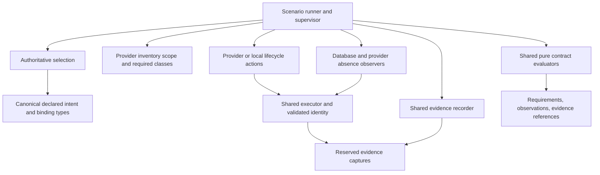

# Proposed qualification ownership model

Status: proposal for review in draft PR #1487. The signatures below describe the
next design, not APIs implemented by the prototype. No harness migration is part
of this proposal. The existing campaign entry points remain authoritative until
their replacements have been reviewed and verified.

## Findings that determine the boundaries

| Existing owner | Mechanism or decision to consolidate | Boundary to preserve |
|---|---|---|
| AWS `live-row.sh`: `run`, `bootstrap_deploy`, `capture_state`, `capture_kube_evidence` | Bounded execution, command records, diagnostic capture | Interactive setup is an explicit command mode; deploy is still through the installed Sol artifact |
| GCP `live-qual.sh`: `run`, repeated branches in `phase_app`, `freeze_evidence`, `finalise_bundle`, `verify_bundle` | Execution records, capture accounting, required evidence, finalization | A successful capture invocation does not mean all its reads succeeded |
| Local `local-qual.sh`: `run_logged`, `write_run_identity`, `phase_capture` | Execution, run identity, evidence manifest | Local behavioral evidence cannot establish a cloud/provider claim |
| AWS/GCP `app_services` / `APP_UNITS`, `app_unit_addresses`, `app_namespaces` | Workload membership, consumer selection, addresses | A list of example services is not proof that every database consumer was selected |
| AWS/GCP `app_verify_database_delivery`; AWS `app_verify_database_ca` | Shared database delivery assertions | Kubernetes reads must remain independent of Sol's write/apply path |
| Local `rows-ocaml.sh` / `rows-ts.sh`: `run_row`, `check_eq`, `check_ge`, `wait_until` | Verdict accounting and bounded observations | Language-specific workloads, queries and scenarios remain distinct; preserve behavioral parity |
| `sol-under-test.sh`, `candidate-binding.sh`, `attempt.sh` | Already shared release/specimen binding | Consolidate by consuming or migrating these owners, not by keeping parallel validators |
| AWS `cleanup` / `phase_destroy`; GCP `cleanup` / `destroy`; local `phase_teardown` | Phase completion, failure capture and cleanup accounting | Different ownership scopes and intentional phase boundaries are not duplication |
| AWS `absence.py`; GCP `inventory` / `provider_probe`; local `cluster_verdict` / `container_verdict` | Uniform observation and verdict envelope | Provider attribution, pagination, identity checks, retention and positive absence remain independent provider reads |
| `transaction.py`, AWS transaction transports, GCP `app_orders_transaction` | Preserve the existing shared structural predicate; consolidate evidence envelopes | Replacing the shared Python predicate with a second OCaml predicate would duplicate ownership |

Source references: [AWS harness](../aws/live-row.sh), [AWS absence](../aws/absence.py),
[GCP harness](../gcp/live-qual.sh), [GCP observer](../gcp/observer.py),
[local harness](../local/local-qual.sh), [OCaml rows](../local/rows-ocaml.sh),
[TypeScript rows](../local/rows-ts.sh), [qualification rules](../README.md).

One concrete defect demonstrates why these boundaries matter: the prototype's
ConfigMap projection checks `ca.crt`, and its offline adapter repeats that premise.
The product's [`Sol_cli_manifest_cluster_env`](../../../cli/lib/workspace/sol_cli_manifest_cluster_env.ml)
declares `db_ca_file_name = "ca.pem"`; the database renderer uses that declaration.
The 31 offline scenarios verify the prototype's mechanism, not agreement with this
product key. A live ConfigMap produced correctly by Sol would fail that prototype
predicate. Adoption must fix the authoritative key input and include a fixture with
the actual contract field. The current executable is not ready to replace either
harness assertion. It stays unchanged during this design-only revision.

There are other limits to preserve explicitly. GCP currently accepts a DML Secret
in any consuming namespace; that is weaker than every selected consumer receiving
its binding. AWS's CA check inspects a volume reference, not each container mount
or a TLS connection. Local row drivers report PASS/FAIL and run deployment before
rows; their envelopes do not currently distinguish all unreadable prerequisites.
These are differences to resolve in contract requirements, not semantics to erase
silently during migration. This proposal does not claim they are all production bugs.

## Authoritative inputs and the shared domain

The matrix remains the home of the claim ID, scope and required evidence class.
A contract implementation owns its executable predicates. Bind the two through
one requirement catalog: any future generated matrix table is a projection of
that catalog, not another manually maintained registry of checks. Existing matrices
stay authoritative until that change is reviewed. Run records stay evidence, and
GitHub stays the work-state authority.

Use a small qualification domain with these concepts:

| Type | Meaning and source |
|---|---|
| `Run.t` | Validated artifact/workspace/harness binding, attempt, specimen, target, scenario and authorization scope; abstract, constructed by one run-binding owner |
| `Claim.t` | Matrix ID, required evidence class and applicable environment/language scope; no caller-controlled success flag |
| `Intent.t` | Canonical declared application/target intent at the candidate revision, before applying it |
| `Binding.t` | Declared resource addresses, credential classes, keys and CA mount contract; product-owned names/types, never inferred naming rules |
| `Consumer.t` | Selected database/resource consumer, language, workload/container identity and its declared binding |
| `Evidence.reference` | Reference to an immutable evidence member within this run, carrying provenance and capture status |
| `Evidence.nonempty` | One reference plus zero or more additional references; every verdict must cite evidence |
| `Issue.t` | Original execution/provider diagnostic with concise qualification context and safe redaction |

For the proposed signatures, these are shared domain modules, not unintroduced
dependencies on production deploy code. Their definitions must remain small and
specific to qualification. Abstract types have one constructor-owning module;
declaring a type abstract in a signature alone does not establish a trustworthy owner.
Constructor-owning components can be nested within one implementation module to
restrict access. These logical signatures do not require one file per interface
or public builder functions that would let observation adapters forge verdicts.

Provenance records the attempt/specimen, candidate and installed bundle identity,
application revision and framework binding, harness revision, target/provider/location,
requested and observed execution identity, command/observation times and origin.
Evidence class and environment scope are separate: a real local observation is
BEHAVIORAL for a local claim, never behavioral evidence for an AWS/GCP claim.
Fixtures are MECHANISM, regardless of whether an adapter labels its payload "live".
Only the run-binding owner establishes origin and scope, and the evaluator checks
them against the claim. Evidence recording does not choose or promote claim scope.

## Proposed interfaces

These signatures establish responsibilities rather than a plugin API. Supporting
types named below are the closed Sol qualification domain described here. This
document is deliberately not a new library or a set of executable `.mli` files.

### Observation and verdict

```ocaml
module Observation : sig
  type 'a state = Present of 'a | Absent | Unknown of Issue.t
  type 'a t = private
    { state : 'a state
    ; evidence : Evidence.nonempty
    }
  (* Construction belongs to the observation boundary: decode + identity/scope
     validation + persisted evidence. Providers cannot return a bare bool. *)
end

module Verdict : sig
  type decision =
    | Pass
    | Fail of Counterexample.t
    | Unknown of Issue.t
    | Not_run of Blocker.t

  type t = private
    { claim : Claim.t
    ; decision : decision
    ; evidence : Evidence.nonempty
    }
end
```

The contract evaluator constructs evaluated verdicts. The runner's accounting
module constructs NOT_RUN for requirements it never dispatched, citing a persisted
blocker or explicit unsupported-capability decision. An absent object is a fact:
it fails a required-presence claim and passes a required-absence claim. An
unreadable object is UNKNOWN, never proof of either. Missing expected evidence
also prevents PASS, even when an action completed successfully.

Keep every leaf verdict. A run is acceptable only if every required applicable
claim is PASS at the right evidence class/scope and evidence finalization succeeds.
FAIL and UNKNOWN can coexist in one run; do not flatten them into a summary that
loses the unknown reads. NOT_RUN is never an exemption from a required claim.
Inapplicable claims have an explicit catalog scope decision, not a fabricated PASS.

| Leaf decision | Example | Evidence required |
|---|---|---|
| PASS | Declared CA key is nonempty at the consumer's declared location | Requirement/binding reference, complete-selection reference, validated identity and successful independent object/key projection |
| FAIL | An authoritative successful read positively finds no required CA object | Same scope references and the positive absence response; retain the counterexample |
| UNKNOWN | Kubernetes returns Forbidden or the projection cannot be decoded | Requested/observed identity, execution outcome and original safe diagnostic or malformed-response capture |
| NOT_RUN | DML observation was never dispatched because selection or identity was unresolved | Persisted prerequisite/selection failure or explicit unsupported-capability decision, with a link to the blocked requirement; no invented observation |

### Selection and requirements

```ocaml
module Selection : sig
  type 'a complete
  type incomplete = { issue : Issue.t; evidence : Evidence.nonempty }

  val database_consumers :
    Run.t -> Intent.t ->
    (Consumer.t complete, incomplete) result

  val members : 'a complete -> 'a list
  val coverage : 'a complete -> Evidence.nonempty
end

module type CONTRACT = sig
  type subject
  type requirement
  type facts

  val requirements :
    Run.t -> subject -> requirement list
  val claim : requirement -> Claim.t
  val evaluate : requirement -> facts Observation.t -> Verdict.t
end
```

Each concrete contract fixes `subject` to its required input: database delivery
uses `Consumer.t Selection.complete`; absence uses the provider scope owner's
abstract coverage. This avoids pretending those two completeness authorities are
interchangeable merely because both enumerate requirements.

`Selection` alone constructs `complete`: callers cannot wrap arbitrary lists in
`Complete`. It enumerates canonical target membership, applies the declared resource
dependency relation, resolves the declared workload addresses, and records included
and excluded members with reasons and source revision. It cannot certify completeness
from running pods, a provider's returned subset, or an operator's `--consumer` list.
No selected object is allowed to disappear merely because observing it failed.

An intentionally partial diagnostic run can use a separate explicit subset input;
it cannot call the universal qualification evaluator. Empty complete selection
does not automatically satisfy a scenario that requires database consumers: the
requirement catalog owns the nonempty-exercise requirement.

Product intent is the membership authority. Reuse pure canonical contract types
and decoding where available; do not call the deploy selection/render/apply path
and treat its returned objects as independent completeness evidence. Where the
current declared contract does not provide enough information to establish binding
addresses or membership, return `incomplete`. Review the missing product declaration
at its owner before migration; do not invent names in the qualification reader or
build a parallel planner.

`requirements` is the only expansion from complete subject selection into required
checks. Observers cannot omit a requirement by omitting a resource from their result.
A failed selection is an UNKNOWN coverage claim; its dependent delivery checks are
NOT_RUN with the same evidence. Known consumers may still be observed diagnostically,
but cannot establish the universal claim.

### Execution and identity

```ocaml
module Identity : sig
  type t
  val establish :
    Run.t -> Role.t -> (t, Issue.t * Evidence.nonempty) result
  val evidence : t -> Evidence.nonempty
end

module type EXECUTOR = sig
  val execute :
    Evidence.capture -> Identity.t -> Command.t -> Execution.t
end
```

`Role.t` is a closed set of scenario roles: operator, publisher, deploy,
cluster-access and qualification transport. `Identity.establish` validates the
scenario-required principal and endpoint/account/project binding and returns an
opaque handle. The executor applies that handle's explicit environment/kubeconfig;
it does not silently fall back to ambient credentials or retry as operator.
Requested identity and observed caller identity remain separate evidence.
Authentication expiry, server-side authorization and endpoint changes still require
runtime checks and produce UNKNOWN on failure.

`Command.t` owns argv, working directory, finite timeout, nonsecret environment,
secret inputs by opaque handles/stdin, allowed capture projection and an explicit
interactive/noninteractive mode. Secret values must not be printable argv fields.
The alpha.37 driver's useful property is loading a password outside argv; its
store path and parsing are operator configuration, not a runner contract.

`Execution.t` distinguishes completed exit status, timeout, signal and spawn failure,
and retains partial stdout/stderr references and timings. The executor owns process
handling, not expected refusal, retries, provider error reinterpretation, claim
success or cleanup policy. Use existing process facilities or GNU timeout for
mechanics; do not introduce another supervisor/retry system. The current CLI helper's
timeout result omits partial output, which is a real gap to resolve before sharing
that helper rather than a reason to duplicate all command semantics permanently.

### Database observation capability and the common contract

```ocaml
module type DATABASE_DELIVERY = sig
  val ca :
    Run.t -> Consumer.t -> Database_ca_facts.t Observation.t
  val dml :
    Run.t -> Consumer.t -> Database_dml_facts.t Observation.t
  val migration_input :
    Run.t -> Binding.t -> Database_ddl_facts.t Observation.t
end

module Database_delivery_contract : sig
  type requirement
  val requirements :
    Run.t -> Consumer.t Selection.complete -> requirement list
  val evaluate :
    requirement -> Database_delivery_facts.t Observation.t -> Verdict.t
end
```

The capability observes; the contract evaluates. The signatures of their facts
must record what was actually read: resource identity and namespace, key presence,
credential class reference, pod volume and container mount/key references, and the
source/execution evidence. No caller-provided `delivered = true` field stands in
for those facts. Credential values stay out of retained facts and diagnostics.

Requirements distinguish CA delivery, DML delivery, DDL migration input, no master
credential copy and application/TLS behavior. Object/key presence and correct
references cannot prove that a password is DML-only or that a TLS handshake succeeded;
those need separately defined behavioral probes. Checking no master copy must itself
positively read the relevant unit Secret/projection; a failed read is UNKNOWN.

CA key, path, credential class and resource binding are inputs from the product-owned
contract at the candidate revision. Whether Kubernetes contains those objects/keys
is an independent observation. The current database identity log does not declare
every DML address or consumer reference: this is a declaration gap to settle before
implementing the full contract, not permission to reproduce `target ^ "-dml-creds"`.

The same assembly works for AWS and GCP:

```ocaml
module Aws_delivery = Kubernetes_database_delivery (Aws_read_context)
module Gcp_delivery = Kubernetes_database_delivery (Gcp_read_context)

module Aws_check = Check_database_delivery (Aws_delivery)
module Gcp_check = Check_database_delivery (Gcp_delivery)

(* Both Check_database_delivery instances obtain requirements from the one
   Database_delivery_contract and call its same evaluate function. Only the
   observation context and provider-backed setup facts differ. *)
```

`Kubernetes_database_delivery` owns common Kubernetes reads/decoding once. The
context modules supply validated identities and endpoints, not different assertions.
`Check_database_delivery` dispatches the closed requirement variants to `ca`, `dml`
or `migration_input`, persists observations and invokes the pure evaluator. It
does not own selection. Local can instantiate this capability only for declarations
its scenario actually supports; local plaintext/application behavior does not imply
support for the cloud CA/credential-class scenario.

### Evidence and provenance

```ocaml
module type EVIDENCE = sig
  type recorder
  val open_run : Run.t -> (recorder, Issue.t) result
  val reserve_capture : recorder -> Capture_spec.t ->
    (Evidence.capture, Issue.t) result
  val execution : recorder -> Execution.t ->
    (Evidence.reference, Issue.t) result
  val observation : recorder -> Recorded_observation.t ->
    (Evidence.reference, Issue.t) result
  val verdict : recorder -> Verdict.t ->
    (Evidence.reference, Issue.t) result
  val checkpoint : recorder -> Checkpoint.t ->
    (Evidence.reference, Issue.t) result
  val finalize : recorder -> Required_evidence.t ->
    (Evidence.manifest, Issue.t) result
end
```

This is one evidence owner, including capture reservation, safe projection/redaction,
file ownership, immutable references, provenance and manifest integrity. The scenario
and requirement catalog declare required evidence; the recorder verifies it exists
and belongs to the right run. It does not decide whether a provider fact satisfies
a product invariant. Record capture failure as data and continue independent captures;
do not confuse "capture accounted for every read" with "every read succeeded".

`checkpoint` preserves the pre-teardown evidence prefix without making the bundle
unwritable. Later teardown observations and the final manifest are appended separately;
they cannot overwrite a failed observation. `finalize` accounts for all declared
requirements, including NOT_RUN and missing captures, and reports incomplete evidence.
Evidence-write failure prevents a conformant PASS but must not suppress authorized
cleanup. Preserve the underlying diagnostic with safe redaction. A local stderr
fallback is an operational diagnostic, not a substitute for a valid manifest.

Use the existing attempt directory and continuation binding; do not add a second
workflow database or local project-status file. Each phase invocation has distinct
capture members within the bound attempt, so continuation does not overwrite prior
evidence or silently make a new specimen reuse an old attempt.

### Lifecycle, supervision and absence

```ocaml
module type LIFECYCLE_ACTIONS = sig
  val prepare : Run.t -> Step.outcome
  val deploy : Run.t -> Step.outcome
  val exercise : Run.t -> Step.outcome
  val destroy : Run.t -> Owned_scope.t -> Step.outcome
end

module type ABSENCE_SCOPE = sig
  type resource_class
  type coverage
  val required_classes :
    Run.t -> Owned_scope.t ->
    (coverage, Issue.t * Evidence.nonempty) result
  val classes : coverage -> resource_class list
  val coverage_evidence : coverage -> Evidence.nonempty
end

module type ABSENCE_OBSERVER = sig
  type resource_class
  val observe :
    Run.t -> resource_class -> Resource_inventory.t Observation.t
end

module Supervisor : sig
  val run : Bound_scenario.t -> Run.t -> Run_report.t
end
```

The scenario binder checks required capabilities before mutation. Unsupported required
capabilities yield explicit NOT_RUN decisions and an unacceptable run; the adapters
cannot implement a missing capability as a successful no-op. `Bound_scenario.t`
binds the chosen action and observation implementations and evidence recorder to a
reviewed Sol scenario. No dynamic plugin registry or arbitrary workflow DAG is needed.

The runner owns ordered phases for that scenario, requirement accounting, explicit
operator pauses and transition into capture/cleanup. Provider action adapters own the
commands within each phase; they do not own verdict aggregation or finalization.
This keeps AWS publisher context, GCP setup/delegation and local provisioning distinct
without giving each adapter its own failure supervisor.

`Owned_scope.t` is validated from the declared target and operator authorization,
not discovered by a naming guess after failure. It distinguishes disposable target
resources, run-owned publication artifacts, durable prerequisites and policy-retained
objects. Review provider retention and attribution at the provider boundary. One
authoritative required-class enumerator exists per provider/scope, consumed by its
observer and the common absence evaluator; a provider cannot submit a smaller list
of successful reads and have it interpreted as complete.

Here `coverage` is abstract and constructed only by that provider's inventory-scope
owner, not by arbitrary read adapters. It is deliberately distinct from the consumer
selector's `complete` type: the owners certify different universes. The provider's
closed class set and full enumeration need hostile/exhaustiveness tests; an abstract
type cannot prove its implementation did not forget a resource class.
The scenario binder pairs `ABSENCE_SCOPE` and `ABSENCE_OBSERVER` with the same
`resource_class` type. The observer cannot choose the required set or certify its
own returned subset as complete.

Supervision is a small fixed sequence:

1. Bind candidate, attempt, selection, identities, required capabilities and cleanup
   authority before issuing a mutating command. Persist the impending action before
   dispatch; from dispatch onward it may have mutated even if no result is received.
2. On failure, timeout or cancellation, account for the blocked requirements and
   attempt all relevant bounded captures. Checkpoint before destructive cleanup.
3. Invoke supported teardown for the validated owned scope, then independently
   inventory every required resource class even when teardown returned nonzero.
4. Preserve post-teardown evidence and finalize. Report contract verdicts, destroy
   execution outcome, absence verdict and evidence completeness as separate results.

Unknown resource state does not establish absence. Unknown ownership or authorization
does not grant permission to destroy. Conversely, a timed-out authorized deploy may
have created resources: it must not evade supported cleanup because a log marker was
never printed. Teardown cannot remove durable prerequisites simply to obtain green
absence. Scenario policy must define separate obligations for intentionally retained
resources, and retained durable infrastructure must never masquerade as disposable
residue or disappear from accounting.

The common absence evaluator quantifies over the complete required classes; each
provider observer owns identity verification, authoritative discovery, pagination,
attribution and interpretation of documented provider responses. Preserve AWS's
existing independent observer and its hostile fixtures initially; wrap its structured
observations, not merely its overall exit code. Do the same for GCP/local inventories.
Neither successful Terraform/Sol destroy nor an empty Terraform state establishes
provider absence. Destroy success and absence success remain separate facts.

Existing explicit specimen retention for delegation/application phases must be a
reviewed scenario boundary with recorded reason and cleanup obligation, not a generic
`KEEP=1` escape from failure handling. Whether those existing boundaries remain is an
operator/design decision before migration; this proposal does not authorize changing
the campaign's behavior. Cleanup is attempted on handled failures and cancellation;
no in-process type or finalizer guarantees cleanup after SIGKILL, host failure or
revoked credentials. Existing bound-attempt destroy/verify continuation remains the
recovery path, and unresolved absence remains UNKNOWN/FAIL as appropriate.

## Dependency direction

Arrows mean "depends on/calls". All interfaces share the small domain types above;
contracts depend only on those types, never on actions, recorder I/O or production
deploy internals.



Sharing immutable product contract definitions is allowed. Sharing the production
function that selected, rendered, applied or verified the very behavior being tested
as its own oracle is not. Parsing an independently captured Kubernetes object remains
qualification-owned; names/formatting are declared by their product owner. For an old
candidate, use its declared contract version/identity, not whatever a newer harness's
production module happens to export. Do not turn candidate-specific field differences
into a growing compatibility framework: review support for the candidate explicitly.

## What the types establish, and what still needs verification

| Proposed restriction | Mistake made harder | Runtime obligation |
|---|---|---|
| Abstract complete selection, constructed once | Omitting a failed consumer from a universal check | Verify canonical membership, exclusions, scope and declaration revision |
| Declared binding keys and addresses | Reader guesses `ca.crt` or reconstructs a Secret name | Independently read the actual declared key/resource; test against the product contract |
| Observation separates absence from unknown | Authorization failure becomes absence | Validate identity, response schema, complete listing and authoritative not-found |
| Identity handle required for execution | Command silently inherits operator context | Verify principal/endpoint and handle auth expiry; opaque types cannot prove server authorization |
| Verdict requires evidence and scope | Exit code or fixture success promotes a claim | Verify evidence integrity, origin, required class and coverage |
| Cleanup scope established before mutation | Timeout suppresses cleanup; durable resources deleted accidentally | Establish ownership/authorization and independently verify absence |
| Private verdict/observation constructors | Provider adapter returns its own PASS | Review constructor owners and mutations; unsafe casts or wrong decoders remain possible |

## Migration sequence and review gates

1. Review this ownership model, full database requirement scope, completeness source,
   identity/capture policy and specimen-retention semantics. Keep #1487 draft. No
   additional executor, DML adapter or lifecycle implementation precedes this review.
2. Establish the needed product-owned declaration surface and pure contract inputs
   in focused changes. Fix the prototype's wrong CA key with a test grounded in that
   authority. Refuse incomplete addresses or membership instead of adding naming rules.
3. Implement the shared domain, selection and database requirements. Specify exact
   facts and evidence per requirement, including UNKNOWN/NOT_RUN. Instantiate the
   same evaluator with AWS and GCP observation contexts in offline fixtures; mutate
   every consumer, declared key, identity, missing read and evidence requirement.
4. Consolidate execution and evidence behind their owners, preserving timeout output,
   secrecy and current candidate binding. Migrate existing shared helpers or retain
   them as the single implementation during transition. Do not keep two validators.
5. Replace AWS database assertion ownership, then GCP, after old/new fixture comparison.
   Retain hostile coverage and document intentional strengthening or corrected old
   semantics. A temporary comparison is a migration tool, not a permanent second oracle.
6. Move common phase accounting and handled-failure supervision into the runner.
   Keep provider actions explicit; preserve independent absence adapters. Mutation
   tests must cover partial deploy, capture failure, interrupted commands, wrong
   identity, destroy failure, unreadable inventory, retained resources and continuation.
7. Bring local and OCaml/TypeScript row accounting under the same evidence/verdict
   model without forcing cloud-only capabilities or equal scenario sets. Preserve
   the single local-cluster ownership boundary and language-specific adapters.
8. Only after those reviews and offline checks, schedule explicitly authorized live
   qualification of the released candidate. Reuse the qualification rules and release
   verdict path. Remove replaced shell mechanisms as each owner takes over; retain
   mechanisms that still own genuinely distinct provider responsibilities.

This sequence targets removal of duplicated decisions and mechanisms, rather than
minimizing interface count or translating Bash line for line. It adds no release
path, scheduler, provider reconciler, background watcher, general retry engine or
repository workflow state.
